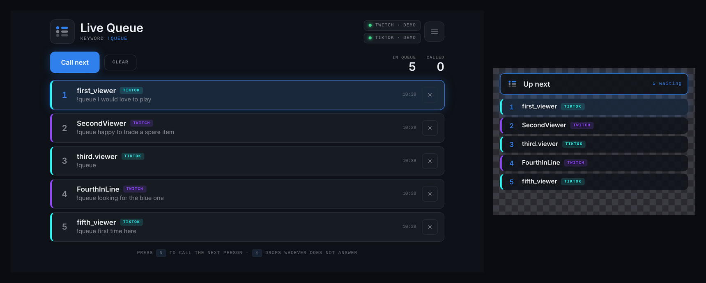

# Live Queue

Una lista di prenotazioni per chi fa giocare gli spettatori in diretta. Lo
spettatore scrive una parola chiave in chat, il suo nome finisce in lista, e tu
lo chiami dal pannello nel browser. Twitch e TikTok alimentano la stessa coda,
quindi non importa da dove stia guardando.

La lista si può mostrare anche agli spettatori, come overlay trasparente in OBS.



- Nessuna dipendenza: serve solo Node.js 22 o superiore.
- Nessun login a Twitch: la chat pubblica si legge in anonimo e il programma non
  scrive mai in chat.
- Niente viene salvato: la coda vive in memoria e sparisce alla chiusura.
- Interfaccia in inglese e italiano, logo e colori personalizzabili.

## Come funziona

```
Twitch  --(chat pubblica, sola lettura)--+
                                         +--> server.js --> pannello nel browser
TikTok  --(Event API di TikFinity)-------+                  overlay per OBS
```

Twitch si collega da solo: basta il nome del canale.

TikTok non ha un'API pubblica per la chat delle live, quindi il programma ascolta
l'Event API locale di [TikFinity Desktop](https://tikfinity.zerody.one), che deve
girare sullo stesso computer ed essere collegato all'account. Nulla comunica
direttamente con TikTok.

## Installazione

1. Installa [Node.js](https://nodejs.org), versione LTS.
2. Scarica il repository, oppure clonalo con `git clone`.
3. Avvia:
   - Windows: doppio clic su `start.bat`
   - macOS e Linux: `./start.sh`
   - oppure `npm start`

Il pannello si apre da solo su `http://localhost:8420`.

Per provarlo senza essere in diretta, con messaggi finti:

```
npm run demo
```

Su Windows c'è `demo.bat`.

## Primo avvio

Apri il menu laterale con il pulsante in alto a destra e compila:

| Impostazione | Valore |
| --- | --- |
| Canale Twitch | il nome del canale, come compare nell'indirizzo |
| Parola chiave | `!queue`, o quella che preferisci |
| Chat da ascoltare | Twitch, TikTok o entrambe |

Nello stesso menu trovi la lingua dell'interfaccia, il caricamento del logo e i
selettori dei colori. Tutto finisce in `config.json` e resta anche dopo il
riavvio.

## Overlay per OBS

Aggiungi una sorgente **Browser**:

| Campo | Valore |
| --- | --- |
| URL | `http://localhost:8420/overlay` |
| Larghezza | 420 |
| Altezza | 600 |

Lo sfondo è trasparente, quindi si vede il gioco sotto. L'overlay usa lo stesso
logo e gli stessi colori del pannello e mostra i primi nomi della lista: quanti,
lo decidi tu.

Se preferisci tenere il pannello dentro OBS, aggiungilo come dock browser
personalizzato su `http://localhost:8420`.

## Comandi

| Azione | Come |
| --- | --- |
| Chiamare il prossimo | il pulsante principale, oppure il tasto `N` |
| Togliere chi non risponde | la `×` sulla sua riga |
| Svuotare la lista | *Svuota* |

L'indirizzo stampato all'avvio, del tipo `http://192.168.1.20:8420`, funziona dal
telefono collegato alla stessa rete. Comodo se giochi a schermo intero su un solo
monitor.

## Configurazione

`config.json` nasce al primo avvio e si modifica dal pannello. Se serve ripartire
da zero, copia `config.example.json`.

| Chiave | Significato |
| --- | --- |
| `language` | `en` oppure `it` |
| `panelTitle`, `overlayTitle` | titoli di pannello e overlay |
| `twitchChannel` | canale da leggere |
| `keyword` | la parola che mette in lista |
| `queueLimit` | quante persone al massimo in attesa |
| `overlayRows` | quanti nomi mostra l'overlay |
| `sources` | `both`, `twitch` o `tiktok` |
| `blockDuplicates` | ignora chi è già in lista |
| `tikfinity` | indirizzo dell'Event API di TikFinity |
| `port` | porta del pannello; richiede il riavvio |
| `theme` | colori dell'interfaccia |
| `logoFile` | logo caricato, dentro `public/` |

### Aggiungere una lingua

In `public/i18n.js` c'è un blocco per lingua. Copia il blocco `en`, traduci i
valori e aggiungi la lingua al menu a tendina in `public/index.html`. Il
controllo lato server accetta i codici elencati nel gestore di `/api/settings`.

## Privacy

La lista non viene mai scritta su disco. Restano solo il nome visualizzato, il
messaggio e la piattaforma, e solo finché quella persona è in attesa.

Su Twitch il programma legge la chat pubblica tramite il gateway IRC anonimo: non
ha token, non scrive e non compie azioni sull'account. Su TikTok i dati arrivano
da TikFinity, che lo streamer installa e collega al proprio account.

Se lo usi in diretta, conviene scriverlo da qualche parte di visibile, per esempio
nella descrizione della live: chi scrive la parola chiave lascia nome e messaggio
in una lista finché non viene chiamato.

## Problemi comuni

| Cosa vedi | Di solito significa |
| --- | --- |
| Spia TikTok rossa | TikFinity chiuso, scollegato, o Event API disattivata |
| Spia Twitch rossa | nome del canale sbagliato, o connessione caduta |
| La finestra si chiude subito | Node.js non installato |
| Porta già occupata | il programma è già avviato in un'altra finestra |

Entrambe le sorgenti si ricollegano da sole: non serve riavviare nulla.

## Licenza

Source available: MIT License con Commons Clause. Puoi usarlo, modificarlo e
condividerlo, anche in dirette monetizzate, ma non puoi venderlo né offrirlo
come prodotto o servizio a pagamento. Vedi [LICENSE](LICENSE).

Non affiliato con Twitch, TikTok, TikFinity o OBS.
