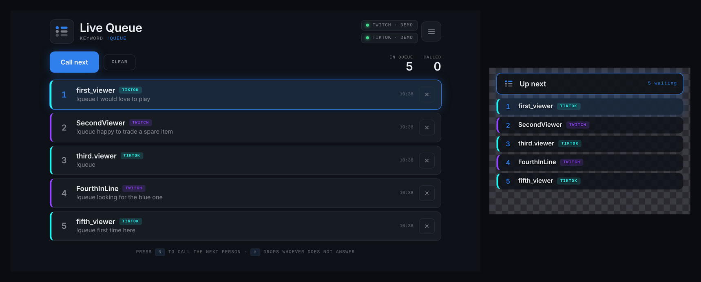

# Live Queue

A sign-up queue for streamers who let viewers join them on stream. Viewers type a
keyword in chat, their name lands in a list, and you call them one at a time from
a panel in your browser. Twitch and TikTok chat feed the same queue, so it does
not matter which platform someone is watching from.

The queue can also be shown to viewers as a transparent overlay in OBS.



- No dependencies. Node.js 22 or newer is the only requirement.
- No Twitch login. Public chat is read anonymously, and the app never posts.
- Nothing is stored. The queue lives in memory and is gone when you close it.
- English and Italian interface, your own logo, your own colours.

## How it works

```
Twitch  --(public chat, read only)----+
                                      +--> server.js --> panel in the browser
TikTok  --(TikFinity Event API)-------+                  overlay for OBS
```

Twitch connects on its own; all it needs is the channel name.

TikTok has no public API for live chat, so the app listens to the local Event API
of [TikFinity Desktop](https://tikfinity.zerody.one), which has to be running on
the same machine and signed in to the account. Nothing talks to TikTok directly.

## Install

1. Install [Node.js](https://nodejs.org) (LTS).
2. Download this repository, or `git clone` it.
3. Start it:
   - Windows: double-click `start.bat`
   - macOS and Linux: `./start.sh`
   - or `npm start`

The panel opens by itself at `http://localhost:8420`.

To try it without going live, with fake chat messages:

```
npm run demo
```

Windows users can double-click `demo.bat` instead.

## First run

Open the sidebar with the button in the top right and fill in:

| Setting | Value |
| --- | --- |
| Twitch channel | the channel name, as it appears in the URL |
| Keyword | `!queue`, or whatever you prefer |
| Chat sources | Twitch, TikTok or both |

The same sidebar holds the interface language, your logo and the colour pickers.
Everything is written to `config.json` and survives restarts.

## OBS overlay

Add a **Browser** source:

| Field | Value |
| --- | --- |
| URL | `http://localhost:8420/overlay` |
| Width | 420 |
| Height | 600 |

The background is transparent, so whatever you are playing shows through. The
overlay follows the same logo and colours as the panel and lists the first few
names; how many is up to you.

If you would rather keep the panel inside OBS, add it as a custom browser dock
pointing at `http://localhost:8420`.

## Controls

| Action | How |
| --- | --- |
| Call the next person | the main button, or press `N` |
| Drop someone who is not answering | the `×` on their row |
| Empty the list | *Clear* |

The address printed at startup, something like `http://192.168.1.20:8420`, works
from a phone on the same network. Handy if you play full screen on one monitor.

## Configuration

`config.json` is created on first run and is edited from the panel. Copy
`config.example.json` if you ever need to start over.

| Key | Meaning |
| --- | --- |
| `language` | `en` or `it` |
| `panelTitle`, `overlayTitle` | headings shown in the panel and the overlay |
| `twitchChannel` | channel to read |
| `keyword` | the word that puts someone in the queue |
| `queueLimit` | how many people can be waiting at once |
| `overlayRows` | how many names the overlay shows |
| `sources` | `both`, `twitch` or `tiktok` |
| `blockDuplicates` | ignore someone already in the list |
| `tikfinity` | address of the TikFinity Event API |
| `port` | port for the panel; takes effect on restart |
| `theme` | interface colours |
| `logoFile` | uploaded logo, stored in `public/` |

### Adding a language

`public/i18n.js` holds one block per language. Copy the `en` block, translate the
values, and add the language to the dropdown in `public/index.html`. Server-side
validation accepts whatever codes are listed in the `/api/settings` handler.

## Privacy

The list is never written to disk. Only the display name, the message and the
platform are kept, and only while that person is waiting.

On Twitch the app reads public chat through the anonymous IRC gateway: it holds no
token, posts nothing and takes no action on the account. On TikTok the data comes
from TikFinity, which the streamer installs and signs in to themselves.

If you run this on stream, it is worth saying somewhere visible, for example in
the stream description, that typing the keyword puts a viewer's name and message
in a list until they are called.

## Troubleshooting

| What you see | What it usually means |
| --- | --- |
| TikTok light is red | TikFinity is closed, signed out, or the Event API is off |
| Twitch light is red | wrong channel name, or the connection dropped |
| Window closes immediately | Node.js is not installed |
| Port already in use | the program is already running in another window |

Both sources reconnect on their own, so there is no need to restart anything.

## Licence

Source available under the MIT License with the Commons Clause. You are free to
use, modify and share it, including on a monetised stream, but you may not sell
it or offer it as a paid product or service. See [LICENSE](LICENSE).

Not affiliated with Twitch, TikTok, TikFinity or OBS.
